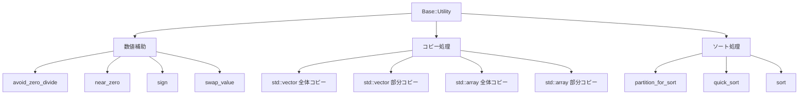

# Base Utility の概要

このドキュメントでは、`base_utility/base_utility.hpp` に実装されている共通ユーティリティ機能を、利用目的と責務の観点から整理して説明します。

## 1. このライブラリの役割

`Base::Utility` 名前空間に定義された機能は、主に次のような処理を安全かつ簡潔に行うための補助機能です。

- 数値のゼロ除算対策
- 変数の入れ替えと符号判定
- `std::vector` / `std::array` のコピー
- 部分コピー
- ソート（Quick Sort）

このヘッダーは「汎用的な配列・ベクトル連携の補助ユーティリティ」を目的としており、特定のアプリケーションではなく、他のC++コードから再利用しやすい形で構成されています。

## 2. 主要機能の一覧

| 機能 | 目的 | 代表関数 | 主な利用シーン |
|---|---|---|---|
| ゼロ除算回避 | 分母が極端に小さい場合でも危険な値を避ける | `avoid_zero_divide` | 数値計算、制御、補正処理 |
| 近似ゼロ判定 | ほぼゼロとみなす範囲を判定する | `near_zero` | 誤差判定、閾値処理 |
| 値交換 | 2つの変数の内容を交換する | `swap_value` | ソート、並び替え、データ交換 |
| 符号判定 | 正負の判定を簡単に行う | `sign` | 方向判定、補正計算 |
| フルコピー | 配列/ベクトル全体をコピーする | `copy(...)` | バッファ転送、データ初期化 |
| 部分コピー | 一部だけを別の位置へコピーする | `copy<Source_Start, Copy_Size, ...>` | バッファ構築、データ分割 |
| ソート | 与えられた配列/ベクトルを昇順で並べ替える | `sort(...)` | 整列、探索前処理 |

## 3. 構造のイメージ



## 4. 数値補助機能

### 4.1 `avoid_zero_divide`

```cpp
template <typename T>
inline T avoid_zero_divide(T in, T division_min)
```

この関数は、分母の絶対値が極端に小さい場合に発生しやすいゼロ除算や数値不安定を防ぐために使います。

動作の考え方は次の通りです。

- 入力値 `in` が `division_min` より小さい
- かつ非負なら、最低でも `division_min` に補正する
- かつ負であり、`-division_min` より大きいなら `-division_min` に補正する
- そうでない場合はそのまま返す

例として、`division_min = 1e-6` の場合、`0.0` は `1e-6` に補正されます。これにより、後続で割り算を行うときにゼロ割りを避けられます。

### 4.2 `near_zero`

```cpp
template <typename T>
inline bool near_zero(T in, T division_min)
```

この関数は「ほぼゼロ」と見なされるかを判定します。具体的には、

- 0 以上で、`division_min` 未満
- または負で、`-division_min` より大きい

といった範囲をゼロに近いとみなし、`true` を返します。

これは、数値計算で微小値を許容範囲として扱う際に便利です。

### 4.3 `sign`

```cpp
template <typename T>
inline T sign(T x)
```

`x >= 0` なら `1` を、`x < 0` なら `-1` を返します。符号付きの値に対する簡単な符号判定として使えます。

### 4.4 `swap_value`

```cpp
template <typename T>
inline void swap_value(T &in_1, T &in_2)
```

2つの変数の内容を入れ替えます。ソート処理やバッファ内のデータ交換で使われています。

## 5. コピー機能

このヘッダーには `std::vector` と `std::array` の両方に対するコピー機能が用意されています。

### 5.1 ベクトル全体のコピー

```cpp
template <typename T, std::size_t N>
inline void copy(const std::vector<T> &source, std::vector<T> &destination)
```

これは `source` の要素を `destination` に順番にコピーします。

- `N` はコピーしたい要素数
- `destination` は事前に十分なサイズを確保しておく前提
- コピー方式はコンパイル時マクロで切り替え可能

### 5.2 配列全体のコピー

```cpp
template <typename T, std::size_t N>
inline void copy(const std::array<T, N> &source,
                 std::array<T, N> &destination)
```

`std::array` に対する全体コピーです。`std::vector` と同様に、同じサイズの配列同士をまとめて複製します。

### 5.3 部分コピー

```cpp
template <typename T, std::size_t Source_Start, std::size_t Copy_Size,
          std::size_t Destination_Start, std::size_t Source_Size,
          std::size_t Destination_Size>
inline void copy(const std::vector<T> &source, std::vector<T> &destination)
```

または

```cpp
template <typename T, std::size_t Source_Start, std::size_t Copy_Size,
          std::size_t Destination_Start, std::size_t Source_Size,
          std::size_t Destination_Size>
inline void copy(const std::array<T, Source_Size> &source,
                 std::array<T, Destination_Size> &destination)
```

これは、ある区間を別の位置へコピーするための機能です。

- `Source_Start` : 元データの開始位置
- `Copy_Size` : 何個コピーするか
- `Destination_Start` : コピー先の開始位置

例:

```cpp
std::array<int, 5> src = {10, 20, 30, 40, 50};
std::array<int, 5> dst = {0, 0, 0, 0, 0};

Base::Utility::copy<1, 3, 2, 5, 5>(src, dst);
// dst = {0, 0, 20, 30, 40}
```

このように、連続した要素を任意の位置へ再配置できます。

## 6. ソート機能

### 6.1 `partition_for_sort`

```cpp
template <typename T>
inline int partition_for_sort(std::vector<T> &input_vector, int left, int right)
```

Quick Sort の分割処理です。枢軸（pivot）を右端に置き、

- pivot 未満の要素
- pivot 以上の要素

に分けて、最終的に pivot の正しい位置を返します。

### 6.2 `quick_sort`

```cpp
template <typename T>
inline void quick_sort(std::vector<T> &input_vector, int left, int right)
```

再帰的に分割して整列します。`partition_for_sort` を使って、左右のサブ配列へ再帰的に処理を進めます。

### 6.3 `sort`

```cpp
template <typename T>
inline void sort(std::vector<T> &input_vector)
```

```cpp
template <typename T, std::size_t N>
inline void sort(std::array<T, N> &input_array)
```

これが利用者向けのエントリーポイントです。入力の `std::vector` または `std::array` をその場で昇順に並べ替えます。

## 7. コピー手段の切り替え

`base_utility_macros.hpp` では、コピー処理の実装を切り替えるマクロが定義されています。

```cpp
// define すると std::copy を使う
#define BASE_UTILITY_USE_STD_COPY_

// define すると memcpy を使う
#define BASE_UTILITY_USE_MEMCPY
```

実際の実装は次の優先順で選ばれます。

1. `BASE_UTILITY_USE_STD_COPY_` が定義されていれば `std::copy` を使う
2. それ以外で `BASE_UTILITY_USE_MEMCPY` が定義されていれば `std::memcpy` を使う
3. どちらも定義されていなければ、独自の再帰テンプレートによるコピーを使う

この設計により、環境や要件に応じて高速化や互換性を調整しやすくなっています。

## 8. 利用上の注意

- 配列・ベクトルのコピー関数は、範囲が有効であることを前提としています。
- `copy` の `destination` は十分なサイズを持つ必要があります。
- 一部のコピー関数は `std::copy` などの前提に依存するため、型に対して比較可能か、メモリとして安全かを確認してください。
- `sort` は Quick Sort を使っているため、安定ソートではありません。

## 9. まとめ

`base_utility.hpp` は、以下のような「基本操作」をまとめた軽量なユーティリティ集です。

- 数値の安全な処理
- コンテナ間のデータコピー
- 部分データの再配置
- 配列・ベクトルの簡単な整列

小さなライブラリでありながら、再利用性や移植性を重視した実装になっており、C++ の基本的なデータ処理を簡潔に行うための基盤として使いやすい設計です。

必要に応じて、このヘッダーを用いた具体例を増やし、より応用的な利用パターンも追加できます。
